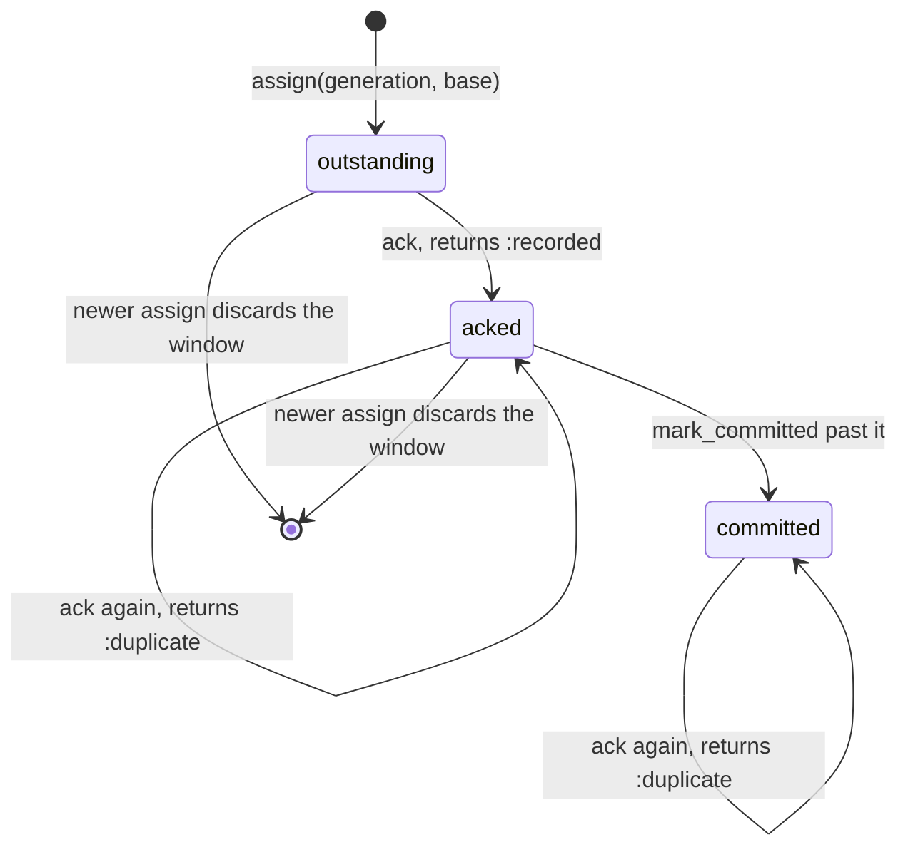
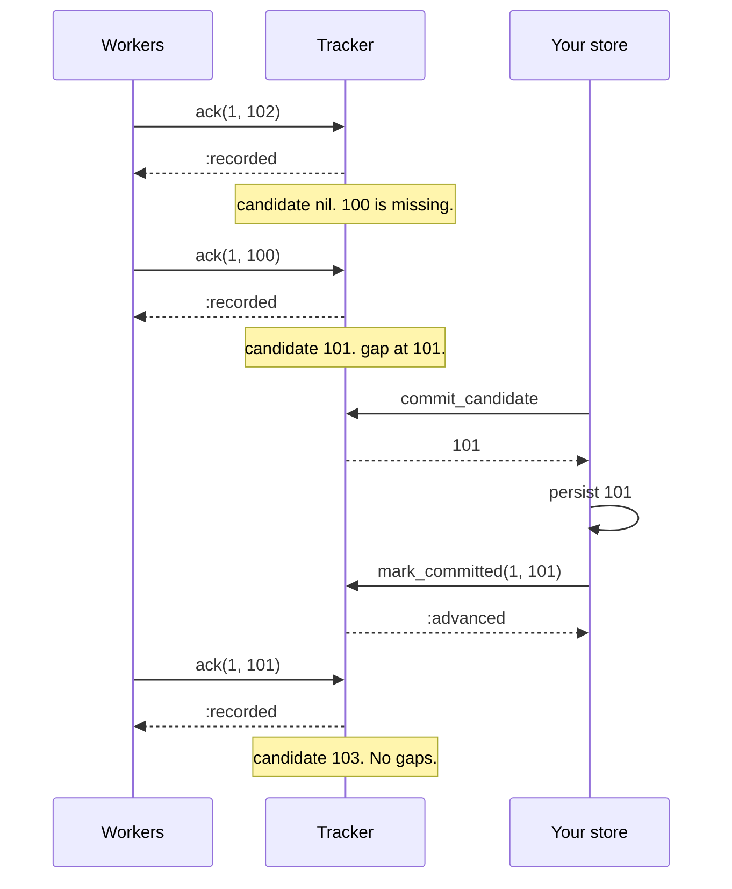

# OffsetMachines

> Offset 102 finishing does not mean offset 101 did.

An acknowledgement tracker for one partition, for Ruby. Your workers finish offsets in whatever order they like. You tell the tracker which ones are done. It tells you the one number that is safe to commit, and which offsets you are still waiting for. You persist that number yourself and confirm it back. Only then does the window move.

This is an initial release and the API is unstable. It is a policy core, not a consumer runtime: it does not fetch, run handlers, talk to a broker, or store anything.

## Quick Start

```bash
gem 'offset_machines'
```

```ruby
tracker = OffsetMachines::Tracker.new
tracker.assign(1, 100)   # generation 1, the store says 100 is next

def finished(tracker, generation, offset, store)
  case tracker.ack(generation, offset) # :recorded and :duplicate both mean "it is acked"
  when :stale
    return # the partition was reassigned. This worker's result is not ours.
  when :out_of_window
    raise "offset #{offset} is past the window, stop fetching ahead"
  end

  candidate = tracker.commit_candidate or return
  store.commit(candidate)
  tracker.mark_committed(generation, candidate)
end
```

One tracker per partition. Generations and offsets are Integers. There is no clock in here at all.

## A Message to the Resistance

So you made your consumer concurrent. Ten workers on one partition, and throughput looks great. Offset 105 finishes first, so you commit 106. Then the process dies with 101 still on a worker's desk. The broker hands you back everything from 106 onward, and 101 is never seen again.

You know what the docs told you to do. "Commit only what you have processed." So you keep a `highest_done` variable. That is the bug you just had, with a name. So you keep a sorted set of finished offsets and walk it under a mutex. Then a rebalance takes the partition away and gives it back, and a worker from before the rebalance acks an offset into the new assignment's set.

The piece you keep rebuilding is a bitmap with a floor: everything below the floor is committed, bits above it are finished work, and the floor only moves across an unbroken run of bits. Plus a generation number, so a worker from a previous assignment gets told no. That bitmap is this gem.

## Chapter 1: Stardate 2026.316, the AMS Kreps

> **AMS Kreps**, NCC-4220, *Kreps*-class log tender.
> The log is only as committed as its first hole.

The tender doesn't carry the log. It carries the tally sheet. Crews report which entries they have finished, in any order, and the tender keeps one mark: the entry up to which nothing is missing. The ship is named for Jay Kreps, who wrote down why the log is the thing everything else hangs off.

On a bridge somewhere, a cadet volunteers:

```ruby
def on_done(offset)
  @highest = [@highest, offset].max
  consumer.commit(@highest + 1)
end
```

"That," says the tender's tallymaster, "commits every entry you haven't finished yet, provided one after it did."

## The Flight Plan

Each offset in the window is in one of these states:



And the afternoon three workers finished out of order:



## How the Tracker Works

### Assign

```ruby
tracker = OffsetMachines::Tracker.new

tracker.ack(1, 100)       # => :stale, nothing is assigned yet
tracker.assign(1, 100)    # => :assigned, generation 1, window starts at 100
tracker.assign(1, 500)    # => :stale, not newer than generation 1
tracker.generation        # => 1
tracker.base              # => 100
```

A new tracker is unassigned and refuses everything. `assign` takes a generation strictly greater than the current one and the offset your store says is next. Generation 0 is never accepted.

`assign` answers `:assigned`, or refuses with `:stale`.

### Ack

```ruby
tracker.ack(1, 102)   # => :recorded, finished out of order
tracker.ack(1, 100)   # => :recorded
tracker.ack(1, 100)   # => :duplicate, already acked
tracker.ack(1, 99)    # => :duplicate, below the window, already committed
tracker.ack(2, 101)   # => :stale, not the current generation
```

An ack records that an offset finished processing. It does not commit anything.

`ack` answers `:recorded` or `:duplicate`, or refuses with `:stale` or `:out_of_window`. `:duplicate` is not a refusal: the offset is acked (or already committed), which is what you asked for. It was just true before you asked.

### Commit candidate

```ruby
tracker.commit_candidate   # => 101
tracker.frontier           # => 103
tracker.acked              # => 2
```

The candidate is one past the unbroken run of acked offsets starting at `base`. It is the number you would hand a broker as "next offset to read". It is `nil` while `base` itself is unacked. `frontier` is one past the highest acked offset, and `acked` counts the bits.

### Acked?

```ruby
tracker.acked?(99)    # => true, below the window: committed
tracker.acked?(100)   # => true, recorded
tracker.acked?(101)   # => false, still outstanding
tracker.acked?(900)   # => false, beyond the window nothing is recorded
```

`acked?(offset)` asks whether an offset is already acknowledged under the current generation: it is below `base`, or its bit is set in the window. It is true exactly when `ack(generation, offset)` would answer `:duplicate`, and it changes nothing. It takes no generation because it reads only the current one. A new tracker answers `false` for everything, and so does a fresh assignment for every offset at or above its base.

### Gaps

```ruby
tracker.gaps(0, 10)     # => [101]
tracker.ack(1, 105)     # => :recorded
tracker.gaps(0, 10)     # => [101, 103, 104]
tracker.gaps(0, 2)      # => [101, 103]
tracker.gaps(104, 2)    # => [104]
```

`gaps(from, limit)` lists the unacked offsets below the frontier, ascending, at most `limit` of them. To page through, ask again from the last one plus one. These are the offsets holding your commit back.

### Mark committed

```ruby
tracker.mark_committed(1, 102)   # => :unacked, 101 isn't done
tracker.mark_committed(1, 101)   # => :advanced
tracker.base                     # => 101
tracker.mark_committed(1, 101)   # => :duplicate
tracker.commit_candidate         # => nil, 101 is the new floor and it's unacked
```

`commit_candidate` only proposes. The window slides when you call `mark_committed` after your store has the offset. You may confirm less than the candidate. You may not confirm more.

`mark_committed` answers `:advanced` or `:duplicate`, or refuses with `:stale` or `:unacked`. `:duplicate` means the offset is at or below the floor, so it is already committed. Confirming twice is harmless.

```ruby
tracker.ack(1, 101)        # => :recorded
tracker.commit_candidate   # => 103
tracker.status
# => #<data OffsetMachines::Status generation=1, base=101, commit_candidate=103, frontier=106, acked=3>
```

### Reassign

```ruby
tracker.reassign(101)            # => 2, the new generation
tracker.acked                    # => 0, the old window is gone
tracker.ack(1, 101)              # => :stale
tracker.mark_committed(1, 102)   # => :stale
tracker.ack(2, 101)              # => :recorded
```

`reassign(base)` is `assign` with the next generation. It answers the new generation as an Integer, or refuses with `:exhausted` when the generation is already `2**64-1`. Every ack from the previous generation is thrown away, including the ones that had not been committed. Those offsets will be delivered again. That is what a rebalance means.

### Capacity

The window holds 256 offsets starting at `base`. Past that, `ack` refuses with `:out_of_window` and records nothing:

```ruby
tracker = OffsetMachines::Tracker.new
tracker.assign(1, 0)
tracker.capacity             # => 256
OffsetMachines::CAPACITY     # => 256

tracker.ack(1, 255)          # => :recorded
tracker.ack(1, 256)          # => :out_of_window
tracker.gaps(0, 1000).size   # => 255

256.times { |i| tracker.ack(1, i) }
tracker.mark_committed(1, 256)   # => :advanced
tracker.ack(1, 256)              # => :recorded
```

The window never grows. An offset that falls outside it is a signal to stop fetching until the slow one finishes, or to shrink your concurrency.

## The Rules of the Tender

- **Generations and offsets are Integers** in `0..2**64-1`. Floats, nil, and strings raise `TypeError`. Out of range raises `RangeError`.
- **Refusals don't raise.** `:stale`, `:out_of_window`, `:unacked`, and `:exhausted` are answers. Only malformed input raises. A refused call changes nothing, not one bit.
- **A repeat is not a refusal.** `:duplicate` from `ack` or `mark_committed` means what you asked for already holds. It is honoured, and it also changes nothing.
- **Every answer, by method.**

  | Method | Honoured | Refused |
  | --- | --- | --- |
  | `assign(generation, base)` | `:assigned` | `:stale` |
  | `reassign(base)` | the new generation (Integer) | `:exhausted` |
  | `ack(generation, offset)` | `:recorded`, `:duplicate` | `:stale`, `:out_of_window` |
  | `mark_committed(generation, offset)` | `:advanced`, `:duplicate` | `:stale`, `:unacked` |

  Each refusal has its own symbol, the snake_case of the core's `Refusal` variant. There is no catch-all.

- **The last offset is reserved.** Offset `2**64-1` is never ackable, so every commit candidate fits in an Integer the tracker accepts back.
- **One tracker, one partition.** Offsets from two partitions in one tracker is a bug the tracker can't see.
- **Frozen means frozen.** `freeze` the tracker and `assign`, `reassign`, `ack`, and `mark_committed` all raise `FrozenError`. Reads still work.
- **Native is required.** There is no pure-Ruby fallback.

## What You Think You're Doing vs Reality

### You Think: "I'll commit the highest offset I've finished."
### Reality: You commit every unfinished offset below it.

A commit is a claim about everything before a number, not about the number. The only number you can honestly commit is the end of the unbroken run. `commit_candidate` is that number, and it stays put until the slow offset finishes, no matter how far ahead the fast ones get.

## What's Yours

The tracker lives in your process and forgets everything when the process does. After a restart or a rebalance, `assign` a newer generation at the offset your store holds. Where generations come from is yours too: a consumer-group epoch, a lease token, a counter you persist. Fetching, running handlers, retrying a failed offset, the commit itself and its durability are all outside the gem. An offset is acked when you say so. If you ack before the side effect is durable, the tracker will cheerfully propose committing past work you can still lose.

## License

MIT License. See [LICENSE.txt](LICENSE.txt) for details.

**Remember: the fast offsets will finish first. The question is whether you commit past the slow one.**
